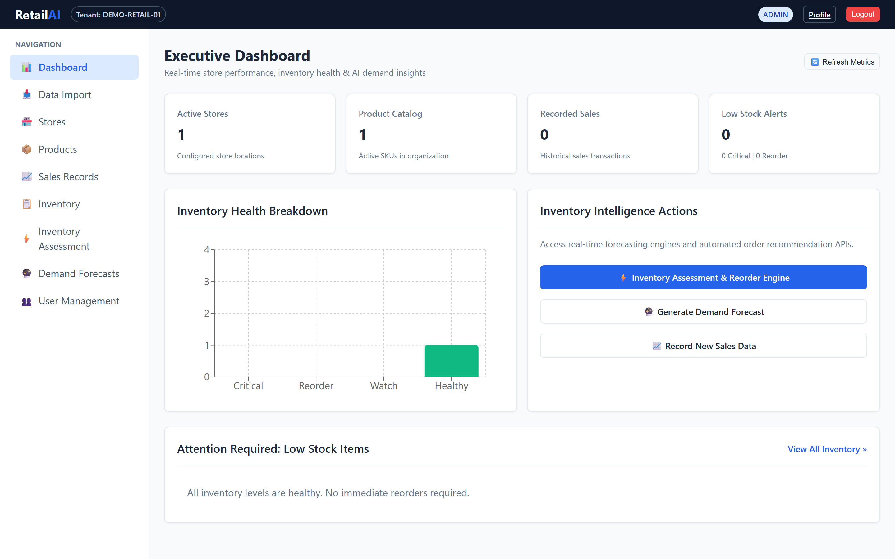
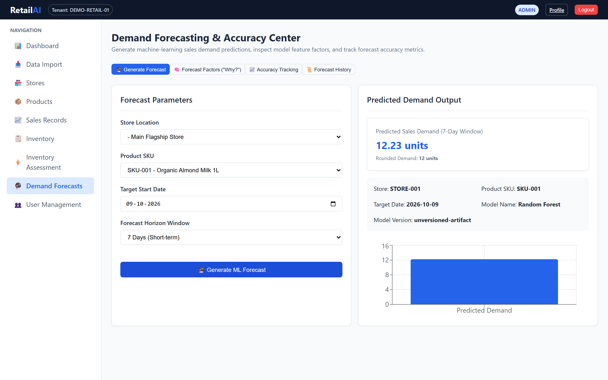
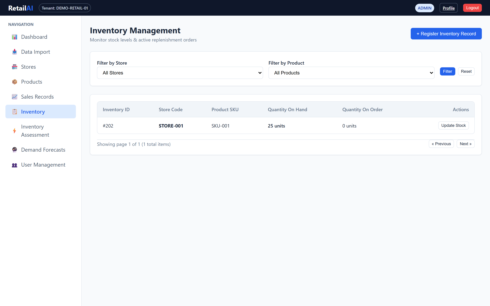
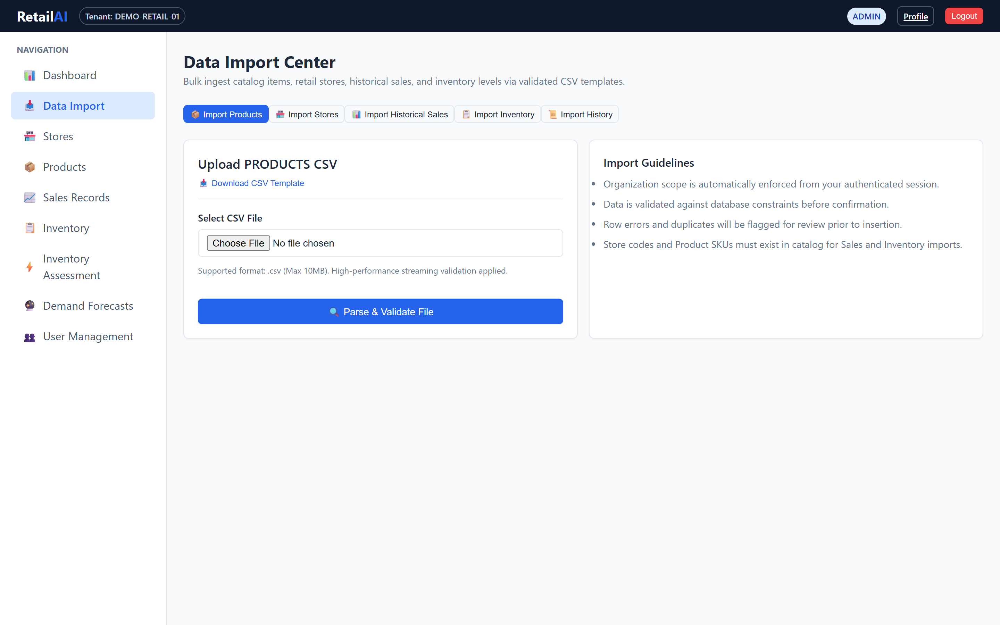
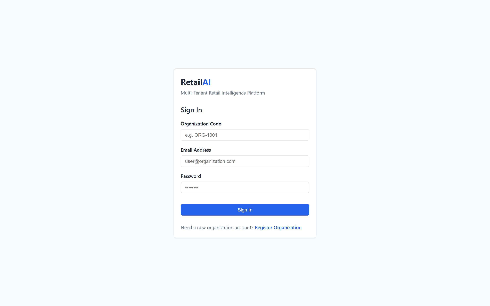
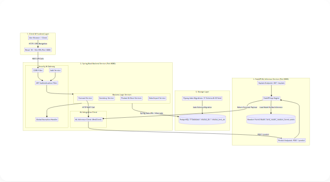
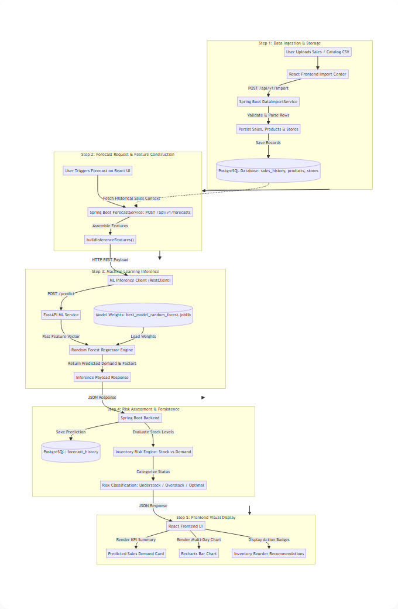

# RetailAI — Multi-Tenant Retail Analytics & Demand Forecasting Platform

RetailAI is a microservices-based enterprise platform designed for multi-tenant retail analytics, inventory risk management, and machine-learning-driven sales demand forecasting. By integrating a **Spring Boot REST API gateway**, a **React 18 single-page application**, and a **FastAPI Python ML inference microservice**, RetailAI empowers retail managers to anticipate sales demand, prevent costly stockouts, optimize reorder workflows, and maintain strict multi-tenant data isolation.

---

## Key Features

- **Multi-Tenant Organization Isolation:** Built-in organization registration and user management, enforcing tenant boundary isolation across JWT authentication tokens, database domain entities, and REST API queries.
- **Machine Learning Demand Forecasting:** Real-time ML inference using a Random Forest regressor trained on retail sales datasets, delivering predicted sales demand and feature importance explanations ("Why?").
- **Inventory Risk Assessment Engine:** Automated stock status categorization (Understock, Overstock, Optimal) comparing current on-hand inventory levels against predicted demand thresholds.
- **CSV Data Import Workflows:** Flexible CSV ingestion center for bulk uploading store profiles, product catalogs, and historical daily sales records into PostgreSQL.
- **Enterprise Security & Configurable CORS:** Stateless JWT authentication, role-based access control (ADMIN, MANAGER, USER), production JWT secret safety guards, and environment-configurable CORS policies.
- **Isolated Automated Test Suite:** Dedicated test database isolation guard preventing automated test execution (`mvn test`) from connecting to or modifying the primary development database.

---

## Application Walkthrough

### Analytics & Operations Dashboard


### Demand Forecasting & Model Inference


### Inventory Assessment & Risk Monitoring


### CSV Data Import Center


### Multi-Tenant Authentication & Registration


---

## Technology Stack

### Frontend Application
- **Framework:** React 18, Vite 5
- **Data Visualization:** Recharts
- **Icons & UI:** Lucide React, Modern CSS Modules
- **HTTP Client:** Axios (with automated JWT request interceptors)

### Backend REST API Gateway
- **Runtime:** Java 21, Spring Boot 3.3.4
- **Security:** Spring Security 6, Stateless JWT (jjwt 0.12.5)
- **Persistence:** Spring Data JPA, Hibernate ORM
- **Migrations:** Flyway Database Migration Engine
- **Build Tool:** Apache Maven 3.9+

### Machine Learning Microservice
- **Runtime:** Python 3.11+, FastAPI, Uvicorn ASGI
- **ML Framework:** Scikit-Learn 1.3+ (Random Forest Regressor), Pandas, NumPy
- **Model Serialization:** Joblib

### Database & Storage
- **Primary Database:** PostgreSQL 17 (`retailai_db`)
- **Test Database:** PostgreSQL 17 (`retailai_test_db`)

---

## System Architecture & Data Flow

### Architecture Diagram
The architecture separates client interaction, API gateway routing, transactional relational storage, and machine learning inference.



*Source file: [`docs/architecture.mmd`](docs/architecture.mmd)*

### End-to-End Data & Inference Flow
The data flow outlines the sequential progression from CSV data ingestion through Spring Boot REST client dispatch, FastAPI Random Forest execution, persistence, and React UI rendering.



*Source file: [`docs/data-flow.mmd`](docs/data-flow.mmd)*

---

## Repository Structure

```text
ML_Project/
├── backend/                  # Spring Boot REST API Gateway & Business Logic
│   ├── src/main/java/        # Security, Auth, Controllers, Services, Repositories
│   ├── src/main/resources/   # Application properties, Flyway migrations (V1, V2)
│   ├── src/test/java/        # Isolated integration tests & safety guards
│   ├── .env.example          # Environment configuration template
│   └── pom.xml               # Maven dependencies & build setup
├── frontend/                 # React 18 + Vite Single Page Application
│   ├── src/                  # Components, Pages, API clients, Context, Routes
│   ├── .env.example          # Environment configuration template
│   └── package.json          # Node.js dependencies & scripts
├── ml-service/               # FastAPI Python ML Microservice
│   ├── app/                  # FastAPI endpoints, inference logic, feature engineering
│   ├── models/               # Trained model artifact (best_model_random_forest.joblib)
│   ├── .env.example          # Environment configuration template
│   └── requirements.txt      # Python dependencies
├── dataset/                  # Dataset references & historical sample data
├── docs/                     # Visual assets & Mermaid architecture sources
│   ├── images/               # Application screenshots & rendered PNG diagrams
│   ├── architecture.mmd      # Architecture Mermaid source file
│   └── data-flow.mmd         # Data flow Mermaid source file
└── README.md                 # Project documentation
```

---

## Quick Start & Local Setup Guide

### Prerequisites
Ensure the following runtimes are installed on your machine:
- **Java Development Kit (JDK):** Version 21
- **Apache Maven:** Version 3.9+
- **Node.js:** Version 18+ & npm 9+
- **Python:** Version 3.11+
- **PostgreSQL Database:** Version 17+

---

### Step 1: Database Setup
Create the development database and isolated test database in PostgreSQL:

```sql
CREATE DATABASE retailai_db;
CREATE DATABASE retailai_test_db;
```

---

### Step 2: Configure Environment Variables

#### 1. Backend Service
Copy the template in `backend/` and configure database credentials:
```bash
cd backend
cp .env.example .env
```
Update `.env` values as required:
```ini
DB_URL=jdbc:postgresql://localhost:5432/retailai_db
DB_USERNAME=postgres
DB_PASSWORD=your_postgres_password
JWT_SECRET=your_base64_encoded_secure_jwt_signing_key_at_least_256_bits_here
CORS_ALLOWED_ORIGINS=http://localhost:3000,http://127.0.0.1:3000
ML_SERVICE_URL=http://localhost:8000
```

#### 2. Frontend Application
Copy the template in `frontend/`:
```bash
cd ../frontend
cp .env.example .env
```
```ini
VITE_API_BASE_URL=http://localhost:8080
```

#### 3. ML Microservice
Copy the template in `ml-service/`:
```bash
cd ../ml-service
cp .env.example .env
```
```ini
PORT=8000
HOST=0.0.0.0
MODEL_PATH=models/best_model_random_forest.joblib
```

---

### Step 3: Launch Services

#### 1. Start Python ML Microservice
```bash
cd ml-service
python -m venv venv
# Windows: venv\Scripts\activate | Linux/macOS: source venv/bin/activate
pip install -r requirements.txt
python -m uvicorn app.main:app --port 8000 --reload
```
*Health Check:* Open `http://localhost:8000/health` in your browser.

#### 2. Start Spring Boot Backend
```bash
cd ../backend
mvn spring-boot:run
```
*Note:* Flyway will automatically execute schema migrations (`V1__init_schema.sql` and `V2__seed_demo_data.sql`) on startup.

#### 3. Start React Frontend SPA
```bash
cd ../frontend
npm install
npm run dev
```
*Access Application:* Open `http://localhost:3000` in your web browser.

---

## Database Isolation & Automated Testing

To prevent accidental data loss, RetailAI includes an automated **Test Database Safety Guard** (`TestDatabaseSafetyGuard.java`).

When running backend unit and integration tests:
- Tests MUST connect to `retailai_test_db`.
- The safety guard checks the JDBC URL before test startup and aborts execution if `retailai_db` (development DB) is targeted.

Execute backend tests safely:
```bash
cd backend
mvn test
```

---

## Core API Endpoints

### Authentication & Tenant Gateway (`/api/v1/auth`)
- `POST /api/v1/auth/register` — Register a new organization and admin account
- `POST /api/v1/auth/login` — Authenticate using organization code, email, and password
- `GET /api/v1/auth/me` — Retrieve current authenticated profile details

### Demand Forecasting (`/api/v1/forecasts`)
- `POST /api/v1/forecasts` — Request demand inference for store ID, product ID, target date, and horizon window
- `GET /api/v1/forecasts/explain` — Fetch feature importance breakdown for a given store/product context
- `GET /api/v1/forecasts/history` — Retrieve historical forecast executions and predictions

### Data Ingestion Center (`/api/v1/import`)
- `POST /api/v1/import/sales` — Import historical daily sales transaction CSV
- `POST /api/v1/import/products` — Import product catalog CSV
- `POST /api/v1/import/stores` — Import store network CSV

---

## ML Evaluation & Model Benchmark

### Training Dataset & Baseline
The underlying forecasting model is a **Random Forest Regressor** trained on historical daily sales transactions from the benchmark **M5 Walmart Retail Dataset**.

### Validation Performance Metrics
Offline evaluation was conducted on a held-out test split of the M5 dataset:

- **Weighted Absolute Percentage Error (WAPE):** `32.49%`
- **Mean Absolute Error (MAE):** `4.5598`
- **Root Mean Squared Error (RMSE):** `6.9628`

*Evaluation Note:* These metrics reflect offline validation performance on the M5 benchmark dataset under specific feature engineering conditions. Performance may vary when applied to different retail categories or store formats.

---

## Technical Limitations & Realities

1. **Target Date Prediction Scope:** The current backend API endpoint returns a scalar sales demand prediction for the selected target date, rather than independent daily point predictions spanning each individual day in the horizon window.
2. **Cold-Start Behavior:** Products or store locations lacking sufficient historical daily sales records default to fallback heuristic predictions until adequate transaction history is accumulated.
3. **Model Retraining:** Newly ingested CSV sales transactions update store records in PostgreSQL but do **not** trigger real-time online model retraining. Updating model weights requires executing offline training scripts.

---

## Deployment Status

RetailAI is currently configured for local containerized development and local microservice deployment. No active public cloud endpoint is currently hosted.

---

## License & Copyright

Copyright © 2026 Tejaswini Chitneedi. All rights reserved.
